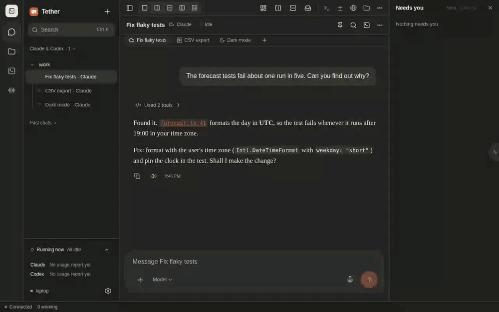

# Tether

Tether is a chat UI for coding agents in tmux: Claude Code, Codex, and Antigravity (`agy`).
Run agents on your Linux machine, then read their chat, approve requests, answer questions, and send instructions from any browser: desktop, tablet, or phone.
The agent stays in tmux when you leave your desk.



- Read chat from the agent's transcript, with tool actions collapsed.
- Answer approval and folder-trust prompts with their real options.
- Switch between agent sessions and shell tabs.
- Attach photos and files, select models, and view usage reports.
- Use `!command` for shell commands in the session's folder.
- Use dictation and push notifications where supported.

The server runs on your machine. There is no Tether cloud account or relay.
Agent providers and optional push services retain their own network and data policies.
Tether is a front end for agent and shell panes, rather than a general tmux client with windows and layouts.

## Repository layout

| Directory | Purpose |
| --- | --- |
| `server/` | Python standard-library server, agent adapters, tests, and legacy UI. |
| `ui/` | React/Vite chat UI. The server serves `ui/dist` at `/chat/`. |

[Upstream screenshots and demo](server/docs/) show the legacy UI, which remains available at `/mobile/chat/`.
They do not show the current React UI.

## Requirements

- Linux. The server uses `/proc` and Linux agent file layouts; macOS is not supported.
- Python 3.10 or newer. CI targets Python 3.12.
- Node.js 22 and npm to build the React UI.
- `tmux` and at least one installed agent: Claude Code, Codex CLI, or Antigravity.
- A systemd user session for the installer. The installer needs no root.
- Optional: [`ttyd`](https://github.com/tsl0922/ttyd) for the interactive terminal, and `pywebpush` for push notifications.

The core server uses only the Python standard library. The React UI requires a build.

## Set up with Claude Code or Codex

The agent offers features and remote access, shows an installer plan, then waits for your yes before apply.

**Claude Code**

1. Run `/plugin marketplace add incmak/tether` in Claude Code.
2. Run `/plugin install tether@tether` and install the plugin.
3. Type `set up tether` or `/tether:tether-setup` and follow the guided setup.

**Codex CLI**

1. Clone this repository with `git clone https://github.com/incmak/tether.git ~/tether`, or use an existing checkout.
2. From the checkout, run the three copy commands in the [Codex setup skill](integrations/codex/skills/tether-setup/SKILL.md#install-this-codex-skill). They move an existing copy aside before copying.
3. Restart Codex if needed, then type `set up tether` or `$tether-setup` and follow the guided setup.

The Codex copy steps use the local skill layout; current [Codex docs](https://developers.openai.com/codex/skills) list `~/.agents/skills`.
If your CLI does not find the skill, copy the folder there instead.
See the [Codex setup skill](integrations/codex/skills/tether-setup/SKILL.md) for details.
See the [Claude Code marketplace docs](https://code.claude.com/docs/en/plugin-marketplaces) for plugin installation details.

## Quick start

1. From the repository root, run `python3 install.py --plan` to check requirements and review the changes.
2. Run `python3 install.py --apply` with the same options. It builds the UI when needed and starts the user services.
3. Start `tmux new -s work`, then run `claude`, `codex`, or `agy` inside it.
4. Open the printed `/chat/` URL. Sign in with the token from the printed file path.

Each Linux user runs the installer separately. It selects the first free chat port from 7683 and separate optional service ports.
Ports occupied by other users count as taken.
The units are `tether.service`, `tether-terminal.service`, and `tether-voice.service`; optional units exist only when enabled.
Existing `mobile-tmux*.service` units stay untouched unless you add `--replace-legacy`, which disables and stops them.
The old `server/deploy/install.py` entry point still works.
To run without a service, use `python3 server/server.py` after the UI build.

## Reaching it from other devices

The server binds to `127.0.0.1` by default. Anyone with access can control your agents and run commands as you.
Do not expose it directly to the internet.

Use a private network such as Tailscale, or an HTTPS reverse proxy with its own sign-in.
For proxy authentication, set `MOBILE_TMUX_AUTH=proxy` and retain the loopback bind.
See the [nginx proxy example](server/deploy/examples/nginx-auth-proxy.conf).

For a trusted LAN, `MOBILE_TMUX_HOST=0.0.0.0` allows token access over the network.
Plain HTTP sends the token and chat without encryption. Push notifications and home-screen installation need HTTPS.
On a phone or tablet, open `/chat/` and use “Add to Home Screen” where the browser supports it.

## Signing in and security

| Mode | Setting | Behavior |
| --- | --- | --- |
| `token` (default) | No setting needed | Creates an owner-only token in `~/.config/mobile-tmux/token`. Sign-in sets an HttpOnly, SameSite=Strict cookie. Failed attempts are rate-limited. |
| `proxy` | `MOBILE_TMUX_AUTH=proxy` | Trusts the reverse proxy's authentication. Refuses startup with a non-loopback bind. |

State changes also need a matching `Origin` and the custom `X-Codex-Mobile` header.
To rotate the token, remove `~/.config/mobile-tmux/token` and restart the service.
Treat the token like an SSH key. Shell commands run as the server user.
Report security problems privately; see [SECURITY.md](SECURITY.md).

Attachments use random names in the owner-only `~/.cache/mobile-tmux/uploads/` folder and expire after a week.
The agent receives the file path. It may request permission to read that folder.
The upload endpoint does not serve files back; authenticated file previews use separate checks for paths, types, and secrets.
Those checks restrict previews to supported files under your home folder and exclude credential folders and secret-like names.

## Usage reports

Claude Code and Antigravity supply usage through status-line hooks.
Run `python3 install.py --apply --hooks` to add hooks where no status line exists.
For Claude Code, this also appends live state hooks without changing existing user hooks.
Session hooks supply mode, effort, tool activity, turn activity, permission waiting, and subagents to the footer.
Mode and effort last until the session ends. A differing mode line from a later screen read takes precedence.
Open tools have no age limit. Other turn state uses the screen after 30 minutes, or after a newer transcript turn.
Screen agent rows and other footer fields remain. Missing or invalid hooks use the screen as a fallback.
The installer preserves an existing status line. To combine one with the recorder, update the agent settings yourself.

For Claude Code, a standalone recorder in `~/.claude/settings.json` looks like this:

```json
{"statusLine": {"type": "command", "command": "python3 /path/to/tether/server/claude_usage.py"}}
```

Antigravity uses `~/.gemini/antigravity-cli/settings.json`, `server/antigravity_status.py`, and `"enabled": true` in that block.
Restart the agent after a hook change. Codex needs no hook.
Without hooks, chat still works, but some usage reports are unavailable.

## Configuration

1. Review changes with `python3 install.py --plan --port 7800 --host 127.0.0.1 --auth token`.
2. Apply them with `python3 install.py --apply` and the same options.
3. To remove services, review `python3 install.py --plan --uninstall`, then run `python3 install.py --apply --uninstall`.

`--json` prints a deterministic plan for tools. Plans write no files and do not start or stop services.
Saved choices live in `~/.config/tether/install.json`. Runs without options reuse them; the plan lists reused choices.
`--terminal` defaults on when ttyd exists. `--voice`, `--push`, `--hooks`, and `--resources` default off.
Each switch accepts a `--no-` form. `--build-ui` forces a build; the default builds missing or stale `ui/dist`.
Voice uses `~/.local/share/tether/whisper-venv`; push shares that environment or uses `~/.local/share/tether/server-venv`.
Uninstall removes only Tether's Claude live state hooks. It keeps status lines, user hooks, tokens, dependencies, and data.
The installer prints the optional `loginctl enable-linger $USER` command for services that must survive logout.
It does not run this command; admin permission may be needed.

For manual startup, use the environment variables below.
For advanced service settings, add `Environment=NAME=value` to a systemd user override and restart the service.

| Variable | Default | Meaning |
| --- | --- | --- |
| `MOBILE_TMUX_HOST` | `127.0.0.1` | Listen address. |
| `MOBILE_TMUX_PORT` | `7683` | Listen port. |
| `MOBILE_TMUX_AUTH` | `token` | `token` or `proxy`. |
| `MOBILE_TMUX_TRUST_FORWARDED` | Off | Set to `1` only behind a local proxy that replaces `X-Forwarded-For`. Rate limits then use the forwarded client address. |
| `MOBILE_TMUX_TTYD_PORT` | `7682` | Optional interactive terminal port. |
| `MOBILE_TMUX_PUSH_SUBJECT` | `mailto:mobile-tmux@localhost` | Contact URL for push services. Set your own contact if you use push. |
| `MOBILE_TMUX_HOME` | Your home | Root for the agent folders: `.claude`, `.codex`, and `.gemini`. |
| `MOBILE_TMUX_CACHE` | `~/.cache/mobile-tmux` | Usage reports and other working data. |
| `MOBILE_TMUX_CONFIG` | `~/.config/mobile-tmux` | Access token and push keys. |
| `MOBILE_TMUX_TMUX` | Found on `PATH` | Path to the tmux executable. |
| `TMUX_CHAT_DIST` | `<repo>/ui/dist` | Override the React UI build folder. |

## Host resources

Enable `--resources` in the installer, or set `TETHER_RESOURCES=1` for manual startup.
Settings → System shows host CPU, memory, disk, and cgroup v2 groups. It refreshes every five seconds while visible.
CPU starts with the second sample; group CPU shows cores used and the share of its limit or host cores.
Missing cgroup files do not stop the host summary.
If btop and the terminal feature are available, “Open btop” opens it in a separate side shell.
Glances process details appear when its local API answers at `http://127.0.0.1:61208`; other URLs are ignored.

## How it works and its limits

The server maps tmux panes to agent conversations and reads each agent's transcript files.
Pending approval and question prompts come from the pane because they are not yet in the transcript.
Before input, the server checks the agent process, conversation, pane identity, and existing draft.
See [server behavior notes](server/docs/behavior.md) for details.

- Use one input surface at a time. Terminal and phone input can race.
- Agent updates can break prompt, picker, or status-line parsing. Report the agent version and a redacted pane sample.
- Two Codex sessions in the same folder can be ambiguous; the second is read-only.
- Chat shows tool calls with expandable results, but not the agent's hidden reasoning.
- Attachments have a 20 MB limit. Text previews have a 2 MB limit.
- Browser speech, push, and installation support varies. Do not rely on offline access.

## Bugs and development

Report bugs and setup questions through [repository issues](https://github.com/incmak/tether/issues).
Include the agent version and relevant `tmux capture-pane -p -t <pane>` output with private data removed.
See [CONTRIBUTING.md](CONTRIBUTING.md) for server tests and UI checks.

## Credits

Tether is built on [Lowell Winston's mobile_tmux_public](https://github.com/LowellWinston/mobile_tmux_public), licensed under MIT.
Parts of the UI derive from [T3 Code](https://github.com/pingdotgg/t3code), also licensed under MIT.
See [third-party notices](THIRD_PARTY_NOTICES.md) for attribution and vendored libraries.
Tether is licensed under the [MIT License](LICENSE).

## Updating

Only tagged releases reach users. A push to `main` does not publish an update.
The server checks the latest stable release once per day without an authentication token.
The sidebar shows a dismissible link to release notes. Each version has its own dismissal.
Failed checks keep the last known result. `off` disables these checks and the banner.

For a release install, place the extracted tree in `~/.local/share/tether/releases/<version>/`.
Create `~/.local/share/tether/current` as a symlink to that directory.
Run `python3 ~/.local/share/tether/current/install.py --apply --no-build-ui`.
The archive contains the built UI. Services use the `current` symlink.
Use `~/.local/share/tether/current/tether` as the CLI, or add a symlink in your local executable directory.

```bash
tether update --check              # Report the latest stable release.
tether update                      # Ask before applying it.
tether update --yes                # Apply without a prompt.
tether update --to v0.2.0          # Select a published version, including an rc release.
tether rollback                    # Restore the previous release.
python3 install.py --plan --updates auto
python3 install.py --apply --updates auto
```

The installer saves `--updates notify|auto|off`. The default is `notify`.
Only `auto` writes the daily `tether-update.timer` and its service.
The timer uses a randomized one-hour delay. Its service runs `tether update --auto`.
Choose `notify` or `off` to remove the timer.

The CLI verifies `SHA256SUMS` before extraction. It rejects unsafe archive paths and links.
It stages the release beside the current release, then changes `current` atomically.
It restarts Tether and checks `/chat/` for 30 seconds.
A failed install, restart, or health check restores the prior release, units, and saved choices.
A successful update keeps the active release and one rollback release.
Updates use a lock to prevent concurrent changes. They preserve chat data and agent transcripts.

A git checkout refuses release updates. Run `git pull`, then `python3 install.py --apply` there.
Set `TETHER_REPO` to choose another release repository. The default is `incmak/tether`.
